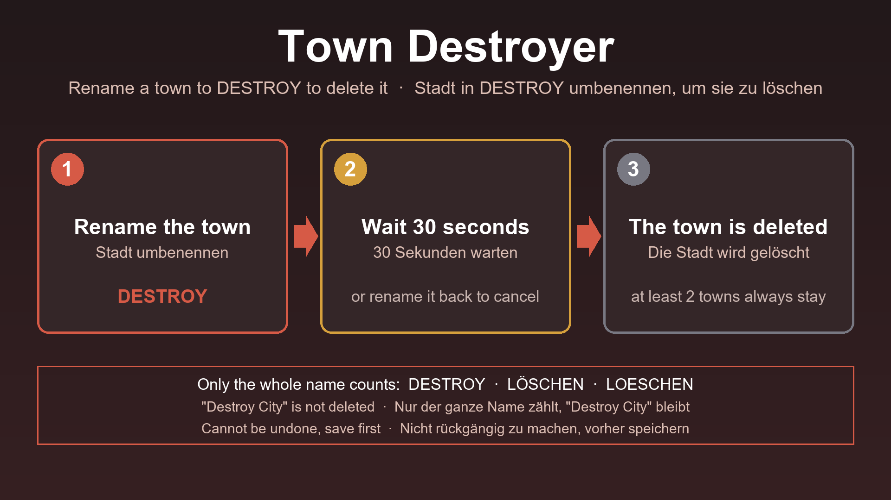

# Town Destroyer (Transport Fever 3)

**EN** | [DE](#deutsch)

**Get it in the in-game Mod Hub** (mod.io): [Town Destroyer](https://mod.io/g/transportfever3/m/town-destroyer)

A script mod for Transport Fever 3. **Rename a town to `DESTROY`** and it is deleted after 30 seconds. Rename it back within 30 seconds and nothing happens.

**Please test it in a new game first, and tell me how it works for you** (see [Feedback](#feedback)).

## How to use

1. **Save your game first.** The deletion cannot be undone.
2. Open the town window and click the pencil to rename the town.
3. Make the name exactly one of these words (any case, spaces around the name are ignored): `DESTROY`, `LÖSCHEN` or `LOESCHEN`.
4. After 30 seconds the town is deleted. To cancel, rename the town back within those 30 seconds.

**Only the whole name counts.** A name that only contains the word is not touched:

| Name | Result |
|---|---|
| `DESTROY`, `destroy`, `Destroy`, `LÖSCHEN`, `Löschen`, `LOESCHEN` | deleted after 30 seconds |
| `Destroy City`, `Port Destroy`, `Destroyer`, `Löschenstadt` | **not** deleted |

## What to expect

- The 30 seconds are real seconds, also when the game runs faster (x2, x3, x4). The pause stops the countdown.
- **At least two towns always stay.** If only two towns are left, a town named `DESTROY` is not deleted.
- The town, its streets and its buildings are removed (`makeTownDestroyCmd`).
- **Stations in the town can stay or be removed.** The stop of a removed station disappears from its line, and the game corrects the line afterwards.
- Depots outside the town, roads outside the town and all industries stay.
- Roads that connected the town to other towns stay behind as dead ends. You can remove them with the bulldozer. **Vehicles can get stuck in these dead ends.**
- The game writes a warning `Town entity does not exist anymore` to its log. That is harmless.

## Install

Open the **Mod Hub** in the game, search for "Town Destroyer" and subscribe. Then activate the mod when you create a game or add it to a savegame. This repository holds the source code and is the place for feedback; the mod is meant to be installed through the Mod Hub.

## How it works

`content/town_destroyer.script.tl` is a game script. Every 5 seconds it reads the names of all towns (`api.engine.util.getEntityName`). The first time it sees a name that is exactly one of the words, it remembers the time. If the name is still the word after 30 seconds and more than two towns exist, it sends `makeTownDestroyCmd` for the town. The 30 seconds are measured in real time: the time the game script gets is game time, so it is divided by the speed of the game (`GAME_SPEED`).

## Tested

Tested on Transport Fever 3, build 40408:
- A town with its name set to `DESTROY`, `löschen` and `destroy` was deleted (13 towns before, 12 after).
- Cancelling by renaming back within the 30 seconds works, at normal speed and at x4. Mixed case and the upper case umlaut (`LÖSCHEN`, `LöScHeN`) are recognized.
- At game speed x4 the deletion came after exactly 30 real seconds.
- With two towns left, a town named `destroy` was not deleted.
- A town with a bus depot, a station and a line with two stops: the depot and the station stayed. The line showed errors at first.
- A town with a station of mine and a line: the station of the line was removed, the game corrected the line afterwards. Two vehicles got stuck in dead ends.

Not tested: several lines or train stations in the town, vehicles with cargo in the town, and the combination with other mods.

## Feedback

Please use [Issues](../../issues) for bugs and [Discussions](../../discussions) for feedback and ideas. Helpful details: game build, other active mods, what was in the town (stations, lines), and the `stdout.txt` from your `crash_dump` folder if the game crashed.

## License

MIT, see [LICENSE](LICENSE).

---

## Deutsch

**Im Spiel über den Mod-Hub laden** (mod.io): [Town Destroyer](https://mod.io/g/transportfever3/m/town-destroyer)

Ein Script-Mod für Transport Fever 3. **Benenne eine Stadt in `DESTROY` um**, und sie wird nach 30 Sekunden gelöscht. Benennst du sie innerhalb dieser 30 Sekunden zurück, passiert nichts.

**Bitte zuerst in einem neuen Spiel testen und mir Rückmeldung geben** (siehe [Feedback](#feedback-1)).

### So geht's

1. **Zuerst speichern.** Das Löschen lässt sich nicht rückgängig machen.
2. Das Stadtfenster öffnen und mit dem Stift die Stadt umbenennen.
3. Den Namen genau zu einem dieser Wörter machen (Groß- und Kleinschreibung egal, Leerzeichen am Rand werden ignoriert): `DESTROY`, `LÖSCHEN` oder `LOESCHEN`.
4. Nach 30 Sekunden wird die Stadt gelöscht. Zum Abbrechen die Stadt in diesen 30 Sekunden zurückbenennen.

**Es zählt nur der ganze Name.** Ein Name, der das Wort nur enthält, bleibt unberührt:

| Name | Ergebnis |
|---|---|
| `DESTROY`, `destroy`, `Destroy`, `LÖSCHEN`, `Löschen`, `LOESCHEN` | wird nach 30 Sekunden gelöscht |
| `Destroy City`, `Port Destroy`, `Destroyer`, `Löschenstadt` | wird **nicht** gelöscht |

### Was du erwarten kannst

- Die 30 Sekunden sind echte Sekunden, auch wenn das Spiel schneller läuft (x2, x3, x4). Die Pause hält den Countdown an.
- **Mindestens zwei Städte bleiben immer.** Sind nur noch zwei Städte übrig, wird eine Stadt mit dem Namen `DESTROY` nicht gelöscht.
- Die Stadt, ihre Straßen und ihre Gebäude werden entfernt (`makeTownDestroyCmd`).
- **Stationen in der Stadt können bleiben oder verschwinden.** Die Haltestelle einer entfernten Station verschwindet aus ihrer Linie, und das Spiel korrigiert die Linie danach.
- Depots außerhalb der Stadt, Straßen außerhalb der Stadt und alle Industrien bleiben.
- Straßen, die die Stadt mit anderen Städten verbanden, bleiben als Sackgassen zurück. Mit dem Abrisswerkzeug lassen sie sich entfernen. **Fahrzeuge können in diesen Sackgassen stecken bleiben.**
- Das Spiel schreibt eine Warnung `Town entity does not exist anymore` ins Log. Das ist harmlos.

### Installation

Im Spiel den **Mod-Hub** öffnen, nach „Town Destroyer“ suchen und abonnieren. Dann den Mod beim Anlegen eines Spiels aktivieren oder zu einem Spielstand hinzufügen. Dieses Repository enthält den Quellcode und ist der Ort für Rückmeldungen. Der Mod ist dafür gedacht, über den Mod-Hub installiert zu werden.

### Getestet

Getestet mit Transport Fever 3, Build 40408:
- Eine Stadt mit dem Namen `DESTROY`, `löschen` und `destroy` wurde gelöscht (vorher 13 Städte, nachher 12).
- Abbrechen durch Zurückbenennen innerhalb der 30 Sekunden funktioniert, bei normalem Tempo und bei x4. Gemischte Schreibweise und der große Umlaut (`LÖSCHEN`, `LöScHeN`) werden erkannt.
- Bei Spielgeschwindigkeit x4 kam das Löschen nach genau 30 echten Sekunden.
- Bei zwei verbleibenden Städten wurde eine Stadt mit dem Namen `destroy` nicht gelöscht.
- Eine Stadt mit Busdepot, Station und einer Linie mit zwei Haltestellen: Depot und Station blieben stehen, die Linie zeigte zunächst Fehler.
- Eine Stadt mit einer Station von mir und einer Linie: Die Haltestelle der Station verschwand aus der Linie, und das Spiel korrigierte die Linie danach. Zwei Fahrzeuge blieben in Sackgassen stecken.

Nicht getestet: mehrere Linien oder Zugstationen in der Stadt, Fahrzeuge mit Ladung in der Stadt und die Kombination mit anderen Mods.

### Feedback

Bitte [Issues](../../issues) für Fehler und [Discussions](../../discussions) für Rückmeldungen und Ideen nutzen. Hilfreich sind: Spiel-Build, andere aktive Mods, was in der Stadt war (Stationen, Linien) und die `stdout.txt` aus dem Ordner `crash_dump`, falls das Spiel abgestürzt ist.

### Lizenz

MIT, siehe [LICENSE](LICENSE).
